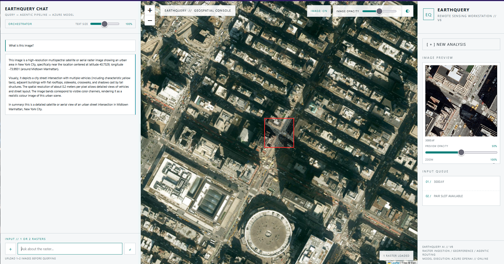
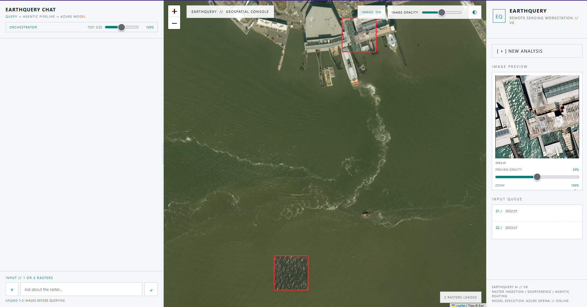
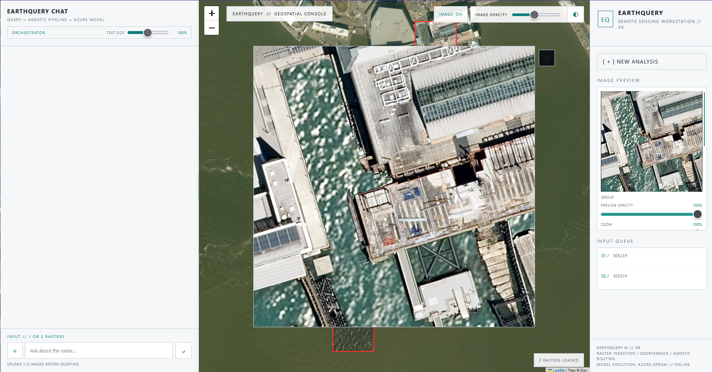
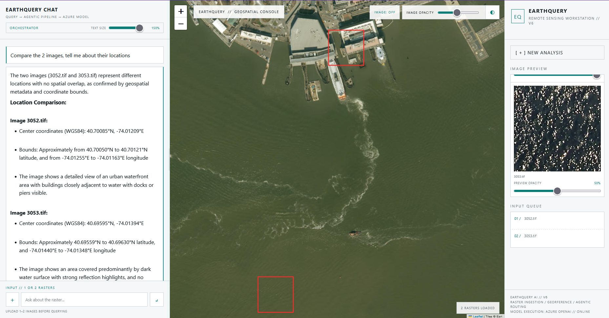
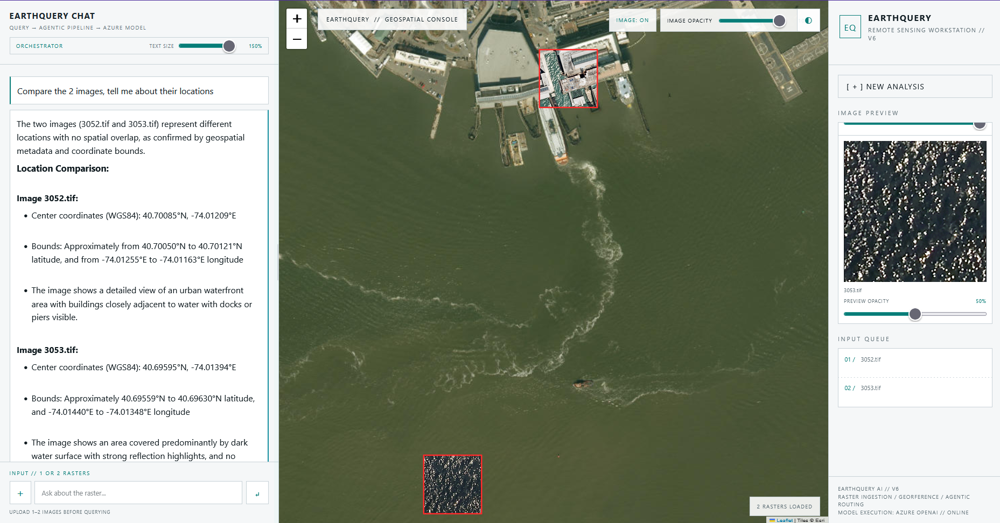

# EarthQuery AI — v6

EarthQuery v6 is the map-first remote-sensing workstation requested for the current SatQuery/EarthQuery build.

## Product walkthrough

Explore EarthQuery’s map-first workflow: analyze a single raster, compare two georeferenced images, inspect image previews, and adjust raster overlays on the map. Select any screenshot to view it at full size.

<table>
  <tr>
    <td width="50%" valign="top">
      <a href="docs/images/demo/single-image-analysis.png"></a>
      <p align="center"><strong>Ask questions about a single raster</strong><br />The answer is paired with the image’s mapped footprint.</p>
    </td>
    <td width="50%" valign="top">
      <a href="docs/images/demo/two-raster-map.png"></a>
      <p align="center"><strong>Load and compare two locations</strong><br />View both raster footprints together in the geospatial console.</p>
    </td>
  </tr>
  <tr>
    <td width="50%" valign="top">
      <a href="docs/images/demo/raster-detail-preview.png"></a>
      <p align="center"><strong>Inspect raster details</strong><br />Open a larger preview while keeping the map in context.</p>
    </td>
    <td width="50%" valign="top">
      <a href="docs/images/demo/location-comparison-answer.png"></a>
      <p align="center"><strong>Get a geospatial comparison</strong><br />The assistant summarizes location and image differences.</p>
    </td>
  </tr>
  <tr>
    <td width="50%" valign="top">
      <a href="docs/images/demo/raster-overlay-comparison.png"></a>
      <p align="center"><strong>Compare overlays on the map</strong><br />Use opacity controls to inspect raster coverage against the basemap.</p>
    </td>
    <td width="50%" valign="top">
      <p align="center"><strong>Built for geospatial exploration</strong><br />Upload one or two images, ask a question, and inspect the evidence in one workspace.</p>
    </td>
  </tr>
</table>

---

## v6 behaviour

- v6 retains the previous map-first remote-sensing workstation UI and geospatial raster ingestion.
- One or two raster images can be loaded together.
- TIFF/GeoTIFF previews are rendered over their full georeferenced footprint.
- Raster metadata, CRS, bounds, WGS84 coordinates and deterministic band/radiometric statistics are extracted before querying.
- The deterministic agentic classifier remains in the request path.
- The Azure OpenAI `gpt-4.1-mini` deployment is now connected to `/ask`.
- The EarthQuery system instructions are loaded once per analysis session.
- The source metadata and rendered visual evidence are sent once when the session is created.
- Subsequent questions use the same conversation history, allowing references to previous questions, answers and visual objects.
- The frontend receives only the model answer and classification. Token usage, cached tokens, reasoning tokens, latency, per-query cost and cumulative cost are kept server-side and written to a timestamped CSV log.
- Each uploaded analysis session gets its own CSV under `logs/`, for example `earthquery_usage_2026-09-23_10-49-31.csv`.

## Model and accounting

The backend uses the same Azure OpenAI endpoint/deployment used by the EarthQuery terminal model laboratory:

```text
Deployment: gpt-4.1-mini
Endpoint: https://satquery-ai-vlm2-resource.openai.azure.com/openai/v1/
```

The API key is read from the `AZURE_OPENAI_API_KEY` environment variable. Never commit the key or place it in browser code.

Pricing is configured from the supplied Azure pricing calculator values:

```text
Input:        ₹0.03822 / 1,000 tokens
Cached input: ₹0.00955 / 1,000 tokens
Output:       ₹0.15287 / 1,000 tokens
```

Cached input tokens are removed from normal input tokens before cost calculation, so they are not charged twice.

The session CSV records:

- query number and timestamp
- question
- model deployment
- source filenames
- prompt/input tokens
- completion/output tokens
- total tokens
- cached input tokens
- reasoning tokens when returned by the API
- normal input tokens
- normal input cost
- cached input cost
- output cost
- total query cost
- cumulative tokens
- cumulative session cost
- latency

None of these accounting fields are returned to or displayed by the web frontend.

## Query routing

### One image

```text
single_image_vqa
single_image_annotation
```

Annotation is selected from explicit annotation/detection/mark/segment/locate style query cues.

### Two images

The pipeline compares the geospatial footprints when both rasters are georeferenced.

```text
same location / before-after
    -> change_detection + vqa
    -> change_detection + vqa + annotation   (when annotation is requested)

different locations
    -> cross_modal_analysis + vqa
    -> cross_modal_analysis + vqa + annotation (when annotation is requested)
```

If the CRS/footprints cannot establish the relationship, the query wording is also considered. The result is surfaced in the model-input payload rather than hidden.

## Model input and orchestration

`/ask` combines deterministic raster context, agentic classification and the active conversation history before calling the Azure model.

```text
Agent orchestration:
SOURCE 1
FILE: image.tiff
IMAGE TYPE: Sentinel-1 SAR raster
...
SPECTRAL/RADIOMETRIC ANALYSIS: ...

Agentic orchestration:
query type: single_image_vqa
input: single_image
operations: vqa
question: What is this image?

model_input_type: earthquery_remote_sensing_v1
model_status: MODEL CALLED — ORCHESTRATION CONTEXT SENT TO AZURE OPENAI
```

The configured Azure model is called after deterministic raster analysis and query routing. Uploaded source images and metadata enter the conversation when a session starts; each question then adds its orchestration context. The frontend receives the answer and classification, while usage and cost accounting stay server-side.

## TIFF/raster understanding

The deterministic context contains:

- raster dimensions and band count
- driver and data type
- CRS/EPSG/WKT
- affine transform and pixel resolution
- native and WGS84 bounds
- WGS84 centre
- NoData
- dataset and band tags
- acquisition information when available
- filename-derived Sentinel-1 information when the naming convention matches
- per-band min/max/mean/std and 2/50/98 percentiles
- dynamic range
- wavelength values when explicitly present in source metadata
- a deterministic bandwise radiometric/spectral profile

No wavelength or sensor semantics are invented when the TIFF does not provide them.

## Project structure

```text
EarthQuery-AI-v6/
├── backend.py
├── agentic.py
├── metadata.py
├── geotiff.py
├── renderer.py
├── model.py
├── index.html
├── requirements.txt
├── README.md
├── .gitignore
├── uploads/
└── logs/
```

## Install

```powershell
pip install -r requirements.txt
```

## Run

Set the key in the same shell, then start the app:

```powershell
$env:AZURE_OPENAI_API_KEY = "<your Azure OpenAI key>"
python -m uvicorn backend:app --reload
```

Open:

```text
http://127.0.0.1:8000
```

## Project presentation

- [SIH 2026 presentation (PDF)](docs/presentation/EarthQuery-AI-SIH2026.pdf)
- [SIH 2026 presentation (PowerPoint)](docs/presentation/EarthQuery-AI-SIH2026.pptx)

## Notes

The map uses Leaflet in the browser. Street tiles use OpenStreetMap and satellite tiles use Esri World Imagery. An internet connection is required for those basemap tiles.

A georeferenced TIFF is rendered to a browser-safe PNG while preserving its original aspect ratio. The PNG is then placed over the map using the source raster's WGS84 footprint. The source TIFF itself is never modified.

For non-georeferenced PNG/JPEG/TIFF files, EarthQuery still extracts raster statistics and can classify the query, but it cannot truthfully place the image at a geographic position on the map.

Runtime uploads, session logs, the multi-gigabyte sample corpus, historical archives, and intermediate presentation build files are intentionally excluded. The final SIH 2026 presentation is included under `docs/presentation/`.
